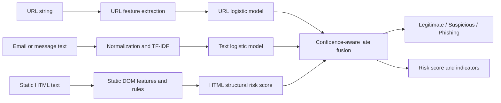

# PhishGuard AI

PhishGuard AI is a research-oriented, multimodal phishing risk screening prototype for URL strings, email/message text, and user-supplied static webpage HTML. It combines independent modality scores through confidence-aware late fusion and returns a three-level decision with indicators to support review.

The system is an academic decision-support prototype. Its scores are not formally calibrated probabilities, and its outputs are not proof that content is safe or malicious.

## Project abstract

Phishing detection signals can appear in a link's structure, a message's language, or a webpage's document structure. This project provides separate baseline analyzers for those input types and a unified interface that can use any available subset. URL analysis is local string parsing. HTML analysis uses a static DOM parser. The URL and email models are trained and evaluated on the provided, independently sourced datasets. Because those datasets are unpaired and there is no labeled raw-HTML corpus, the project does not claim validated real-world multimodal accuracy. The fusion experiment is explicitly exploratory.

## Key features

- URL lexical and structural feature extraction with a logistic-regression baseline.
- Email/text word and bigram TF-IDF with logistic regression.
- Static HTML structural indicators and a transparent rule-based risk score.
- Single-, two-, or three-modality inference with confidence-aware late fusion.
- Three labels: Legitimate, Suspicious, and Phishing.
- Streamlit demonstration app with scanner, dataset dashboard, experiment results, and methodology pages.
- Reproducible preparation, training, experiment, and test scripts.
- No live URL requests, DNS lookups, JavaScript execution, or external HTML-resource fetching.

## System architecture



For one active modality, the system returns its score directly. For multiple modalities, it dynamically normalizes the configured weights after multiplying each by its confidence. See [architecture.md](documentation/architecture.md) and [methodology.md](documentation/methodology.md) for details and limits.

## Folder structure

```text
app.py                         Streamlit demonstration app
data/raw/                      Provided URL and email source datasets
data/raw/extra_email_sources/  Additional preserved email CSV sources
data/processed/                Clean, stratified train/validation/test CSVs
models/                        Baseline models and JSON configuration/results
src/                           Analyzers, training, prediction, experiments
utils/                         Preprocessing and evaluation helpers
tests/                         Unit and integration tests
notebooks/experiments.ipynb    Reproducible results and chart notebook
documentation/                 Architecture, methodology, results, and safety
```

## Setup and installation

Python 3.10 or newer is recommended. From the project root in PowerShell:

```powershell
python -m venv venv
.\venv\Scripts\Activate.ps1
python -m pip install -r requirements.txt
```

The processed CSVs and trained model artifacts are included in the workspace. To regenerate data splits from the preserved source CSVs, run `python src/prepare_data.py`. To retrain baselines, run `python src/train_models.py`; this overwrites the model artifacts and is not required for the demo.

## Run the application

```powershell
streamlit run app.py
```

Then open the local URL printed by Streamlit, usually `http://localhost:8501`.

The app's four sections are Detection Scanner, Project Overview, Experiments, and Methodology & Safety. Scanner inputs remain in the active Streamlit session and are not saved to project files or a database. Uploaded HTML is read as text and parsed without execution or rendering as HTML.

## Reproduce tests and experiments

```powershell
pytest -v
python src/evaluate_experiments.py
```

The experiment command evaluates the provided held-out URL and text test sets, checks authored HTML fixtures, creates the charts in `documentation/charts/`, and writes detailed results to `documentation/experiment_results.md` and `models/experiment_metrics.json`. For the interactive notebook, install Jupyter optionally with `python -m pip install notebook`, then run `jupyter notebook notebooks/experiments.ipynb`. Its cells read the saved results and charts; they do not retrain models.

## Real experimental results

Results below are loaded from `models/experiment_metrics.json`; E1 and E2 use separate held-out test splits. Positive class is Phishing (`1`).

| Evaluation | Accuracy | Precision | Recall | F1-score | False positive rate |
|---|---:|---:|---:|---:|---:|
| URL-only (E1) | 0.779111 | 0.507864 | 0.638474 | 0.565729 | 0.179978 |
| Text-only (E2) | 0.985949 | 0.983756 | 0.989420 | 0.986580 | 0.017842 |
| Controlled URL/text late fusion (E4) | 0.985949 | 0.987072 | 0.985997 | 0.986534 | 0.014104 |

The E4 numbers come from controlled pairings of real test rows by class and source row order. The source datasets have no linkage, so E4 is not a measure of naturally paired multimodal performance. In this selected exploratory pairing, fusion lowered false positive rate relative to text-only while recall was slightly lower. This should not be generalized without a paired test corpus. E3 passed 4 of 4 authored HTML structural checks; this is not an HTML accuracy estimate. See [experiment_results.md](documentation/experiment_results.md) for confusion matrices, protocol, and E5 error analysis.

## Responsible-use disclaimer

Use PhishGuard AI as a review aid. Do not treat a low score as proof that a link or message is safe, and do not treat a high score as definitive proof of malicious intent. Verify sensitive requests through a separate trusted channel. Do not submit confidential messages unless authorized by your organization or research protocol.

## Dataset note

Processed baseline data comes from the supplied `phishing_site_urls.csv` and `phishing_email.csv`. Additional supplied email sources remain preserved under `data/raw/extra_email_sources/` and are not included in the reported baseline results. Exact row counts and cleaning records are in [dataset_log.md](documentation/dataset_log.md).
