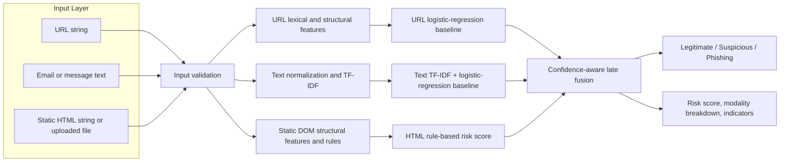

# PhishGuard AI Architecture

PhishGuard AI uses independent analyzers for URL strings, email/message text, and user-supplied static HTML. Each available modality produces a risk score and local indicators. The inference pipeline combines scores only at the late-fusion stage.

## Components

- `src/url_analyzer.py` parses URL strings locally and extracts lexical/structural features. It does not open the URL, perform DNS resolution, or follow redirects.
- `src/text_analyzer.py` normalizes message content and provides the trained word/bigram TF-IDF pipeline and learned-term explanations.
- `src/webpage_analyzer.py` parses supplied markup with BeautifulSoup's built-in `html.parser`. It counts DOM structures and applies a transparent rule score. Script elements are counted as markup; their contents are never run. Referenced resources are never fetched.
- `src/multimodal_fusion.py` dynamically renormalizes configured weights for available modalities. A single modality passes through unchanged.
- `src/prediction.py` lazily loads model/config artifacts once per process and returns the unified decision, modality breakdown, and indicators.
- `app.py` exposes the scanner and research artifacts in a four-section Streamlit application. User HTML is displayed only in a text input/code-safe context, never rendered as markup.

## Important data boundary

The URL and text datasets are from separate sources and have no sample-level IDs in common. The project has no labeled raw-HTML training corpus. Consequently, E1 and E2 are independently measured modality results; E3 is a fixture check; and E4 is only a controlled, explicitly unpaired score-combination experiment. E4 is not evidence of naturally paired multimodal generalization. See `documentation/fusion_methodology.md` and `documentation/experiment_results.md`.
